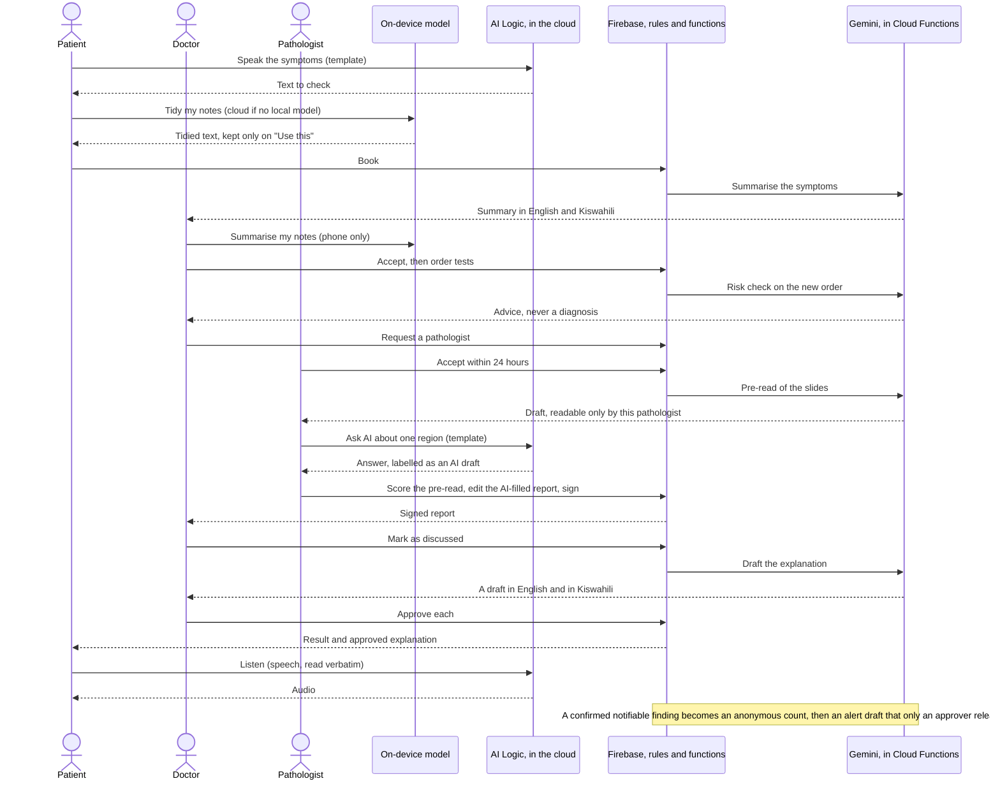

<div align="center">


# Tabibu

![coverage][coverage_badge]
[![style: very good analysis][very_good_analysis_badge]][very_good_analysis_link]
[![License: MIT][license_badge]][license_link]

</div>

<div align="center">

<sub><i>"It is difficult to get the news from poems yet men die miserably every day for lack of what is found there."</i><br>
William Carlos Williams, physician and poet, in
<a href="https://poets.org/anthology/flowers-0">Asphodel, That Greeny Flower</a> (excerpt)</sub>

</div>

A biopsy is a few cells on a glass slide, and the news is in them. Someone has to be able to read it.
In Kenya that someone is scarce: [Brand and colleagues](https://pmc.ncbi.nlm.nih.gov/articles/PMC6180785)
(*Journal of Global Oncology*) report earlier studies putting the country at one pathologist for more
than 725,000 people, and, among the public hospitals they surveyed that could do histology, a median
wait of about 14 days for a result, with none inside the five days they call suggested. The reading
is only one stretch of that wait. The others are the order, the hand-off to a pathologist, the
report and its explanation, and those are the ones software can shorten.

Tabibu is my answer. It connects patients, doctors and
pathologists in Nairobi, in English and Kiswahili, and one record carries a person from booking to
result. AI prepares the pathologist's first read, the plain-language explanation and an outbreak
alert draft. A qualified person always decides: the pathologist signs, the doctor approves what the
patient reads, and an approver releases an alert.

**What I claim, and what I do not.** I claim the path: one order that becomes one case, a pathologist
who gets a pre-read to check instead of a blank page, and a patient who reads a signed result only
once their doctor has talked it through. I do not claim the AI reads slides well, so the pre-read is
shown as a prompt, its confidence is capped at Low, and nothing reaches a person without a human
decision.

### The story in five beats

The three-minute demo walks the same path, one role at a time. Sign in with the accounts under
[Trying it](#trying-it) and follow along.

| Beat | Who | What to watch for |
|---|---|---|
| 1. A question | Patient | Books a doctor near them and types or says what is wrong; the doctor receives it in two languages |
| 2. An order | Doctor | Accepts, orders a test, and asks a pathologist; the AI risk check advises and never clears |
| 3. The read | Pathologist | A desk of cases, a pre-read labelled as AI, scored by the pathologist before they write a word, then signed |
| 4. The news | Doctor, then patient | The doctor discusses the result and approves the explanation; only then does the patient see it, in Kiswahili if they choose |
| 5. The county | Approver | A confirmed finding becomes an anonymous count; an alert draft waits for a person to release it |


**Why beat 5 matters most.** The same scarcity shapes outbreaks. When confirming a disease depends on a
few people who can read a slide or run a test, a county learns of a cluster late. The World Health
Organization keeps COVID-19, Ebola virus disease and Marburg virus disease among its current
[priority diseases for research and development](https://www.who.int/activities/prioritizing-diseases-for-research-and-development-in-emergency-contexts),
and its [fact sheet](https://www.who.int/news-room/fact-sheets/detail/ebola-disease) puts the average
Ebola case fatality rate at around 50%, varying from 25% to 90% in past outbreaks. In May 2026 Kenya's
Ministry of Health issued a
[public advisory on the Ebola outbreak in Ituri Province](https://health.go.ke/sites/default/files/2026-05/PRESS%20RELEASE_EVD_DRC_Final.pdf)
in the Democratic Republic of the Congo. The alert engine is built for that gap. When a pathologist
signs a confirmed notifiable finding it becomes an anonymous count, with no patient and no clinic in
it. When a county's count calls for it, a draft alert in English and Kiswahili, grounded in Ministry
of Health and WHO guidance, waits for an approver, and only then reaches clinicians and then the
patients of that county. I do not claim this saves lives. I claim it removes one delay between a
confirmed result and a warning, and keeps a person in charge of the warning. The design is in the
[outbreak alert engine](docs/architecture/reports/outbreak_alert_engine.md).

Each role, in a line:

- **Patients** book doctors near them and read their results once their doctor has discussed
  them.
- **Doctors** see their day, order tests, and join multidisciplinary (MDT) consults.
- **Pathologists** work a desk of cases the AI read first, and sign every report themselves.

I submit Tabibu on iOS, with an Android APK for testing. It is built with Flutter, talks only to
Firebase, and holds no model key. The AI runs in three places:

| Where | What runs there | Model |
|---|---|---|
| **On the phone**, through Firebase AI Logic hybrid inference | A patient tidies their typed symptoms before booking; a doctor summarises their own notes while ordering | Apple Foundation Models on iOS, Gemini Nano on Android. Without a local model, the tidy falls back to `gemini-3.5-flash-lite` in the cloud; the notes summary never leaves the phone, so it is offered only where the phone has one |
| **In the app, in the cloud**, through Firebase AI Logic | Spoken symptoms become text, and a pathologist asks about one region of a slide, both through server prompt templates; a patient listens to the explanation their doctor approved | `gemini-3.8-flash` for the two templates; `gemini-3.8-flash-tts`, voice Achernar, for speech |
| **In Cloud Functions**, on Gemini through the Agent Platform and the functions' own service account | The symptom summary, the risk check, the pathology pre-read, the report translation, the explanation drafts and the outbreak alert draft | `gemini-3.8-flash` |

> [!NOTE]
> Every AI job has its own Remote Config switch, on the server and in the app, so any one can be
> turned off without a release; the alert draft falls back to a fixed template whenever a check
> fails. Voice notes in the chats are recorded and played, not transcribed. Every AI output is a
> draft: a pathologist signs the report, the doctor approves the patient's explanation, and an
> approver releases an alert. The [AI service](docs/architecture/reports/ai_preread_service.md)
> says what each job sees and does.

## How it works

Each step is a Firestore write that a Cloud Function checks, and each step notifies the next
person. The order **is** the case, so one record carries a patient from booking to result.

In the AI column, **Phone** is the on-device model, **App** is a Firebase AI Logic call from the
app to the cloud, and **Server** is a Cloud Function calling Gemini.

| Step | What happens | AI: where, and which model |
|---|---|---|
| 1. Book | A patient books a doctor and types or speaks their symptoms. | **App**, `gemini-3.8-flash` (template): speech becomes text for the patient to check. **Phone**, falling back to `gemini-3.5-flash-lite`: the patient may tidy their own text, which changes only on "Use this". **Server**, `gemini-3.8-flash`: a symptom summary in English and Kiswahili for the doctor |
| 2. Accept | The doctor accepts, and the slot shows as busy on their public profile. | None |
| 3. Order | The doctor orders tests. The order gets an `ODR-…` number, and the payment method (cash, or an insurer and policy number) is recorded. Tabibu takes no money. | **Server**, `gemini-3.8-flash`: a risk check suggests tests and, from a fixed template, a protocol advisory; it advises and never clears. The doctor's notes are translated for the pathologist. **Phone only**: the doctor may summarise their notes, never stored or sent |
| 4. Assign | The doctor requests a pathologist, who has 24 hours to accept. | None |
| 5. Pre-read | For an image-bearing test, slides go up; the pathologist's desk ranks every case. | **Server**, `gemini-3.8-flash`: the pre-read, a label per tile, a heatmap and measurements built in code, and a draft report, readable **only by the case's pathologist** (S-1). **App**, `gemini-3.8-flash` (template): Ask AI answers a question about one region of a slide, labelled as an AI draft, not a result |
| 6. Score and sign | The pathologist scores the pre-read, then edits the report and signs it. The doctor opens it with a code from their inbox, behind the device's biometrics. | The pre-read's draft fills the report's diagnosis and comments, marked as AI until the pathologist edits them. **Server**, `gemini-3.8-flash`: the report's translation, which the pathologist approves in one tap |
| 7. Release | The patient books a discussion. Only when the doctor marks it discussed does the patient see the result (S-3). | **Server**, `gemini-3.8-flash`: a plain-language explanation in English and in Kiswahili, each approved by the doctor before the patient sees it. **App**, `gemini-3.8-flash-tts`: the patient can listen to the approved text, read verbatim in a voice labelled as computer-generated |
| 8. Talk | Direct threads and MDT discussions carry text, images and voice notes. | None: voice notes are recorded and played, not transcribed |
| 9. Alert | A pathologist's confirmed notifiable finding becomes an anonymous count. When a county's count calls for it, an alert is drafted. | **Server**, `gemini-3.8-flash`: an English and Kiswahili draft, grounded in bundled Ministry of Health and WHO guidance. It reaches clinicians, then patients in that county, **only after an authorised clinician approves it** |



> [!IMPORTANT]
> AI output reaches a person through a one-tap approval, or, where the threat model's S-8 names the
> reader as the qualified person who acts on it, directly. Either way it is labelled as AI.

The details are in the [architecture](docs/architecture/reports/mobile_architecture.md), the
[AI service](docs/architecture/reports/ai_preread_service.md), the
[notifications engine](docs/architecture/reports/notifications_engine.md), the
[outbreak alert engine](docs/architecture/reports/outbreak_alert_engine.md) and the
[threat model](docs/security/reports/firebase_and_ai_service_threat_model.md). The
architecture's §16 says what is live and what is not.

## Running it

You need the Flutter version in `pubspec.yaml`, and Java 21 and Node.js for the Firebase
emulators.

| Step | What happens |
|---|---|
| 1. `flutter pub get` | Fetches the packages |
| 2. `make gen` | Generates the models, routes, injectables and assets |
| 3. `make run-dev` | Runs the development flavor |

You are done when the app launches on a simulator or device without a build error.

**If it goes sideways:**

- A missing `*.g.dart`, `*.freezed.dart` or `gen/` import means step 2 has not run; run `make gen`.
- A missing `AppLocalizations` string means the localizations are stale; run `make l10n`.
- `make run-dev` passes the App Check debug token from the macOS Keychain. Without one the app
  still builds and runs, because App Check is active but not enforced.

There are three flavors, `development`, `staging` and `production`, each with its own entry point
in `lib/main_<flavor>.dart`.

## Trying it

The live project has one demo account per role, all with demo data only. Sign in with email and
password:

| Role | Email | Who |
|---|---|---|
| Patient | `tabibu.demo+patient@gmail.com` | Amina Otieno, Nairobi |
| Doctor | `tabibu.demo+doctor@gmail.com` | Dr. Achieng Odhiambo, Mbagathi District Hospital; also the alert approver |
| Pathologist | `tabibu.demo+pathologist@gmail.com` | Dr. Wanjiru Kamau, Kenyatta National Hospital |

> [!NOTE]
> The demo accounts work on the iOS app and the Android APK. The
> [Drive folder](https://drive.google.com/drive/folders/1vupFwEUAz7L0DJBePR35bNW94c-0E4XV?usp=sharing)
> has the APK and how to set up and sign in to each account.

The accounts come from `make seed-live`, which also adds two clinic patients and an admin account for
the Firebase console.

**Voice.** At booking, a patient can speak their symptoms; the recording becomes text for them to
check before sending. The chats have a microphone in the composer too, where a voice note is
recorded and played back, not transcribed. The first recording asks for the microphone permission.

So that a patient's search and a doctor's pathologist picker have people to show, `make
seed-directory` adds 16 doctors and 6 pathologists from
[`functions/data/demo_directory.json`](functions/data/demo_directory.json): fictional people at
real Nairobi facilities, each with a `DEMO-` licence number. Their photos are stock models from
[Pexels](https://www.pexels.com/license/), free to use, with each photographer recorded in the
file; they are not pictures of the named people.

`make seed-cases` then gives the three accounts fourteen backdated cases at different stages, with
two alerts. Ids are keyed by `SEED_CASES_TAG` (empty by default). The slides are real public data
(PatchCamelyon tiles, CC0, and cells from the U.S. National Library of Medicine's thin-smear set,
fetched at seed time). The pre-reads are stored examples, each marked as one in the app, not live
model output.

**Slides for each test.** Only the tests a pathologist reads under a microscope take slides and a
pre-read; which ones is fixed in `functions/src/lab-tests.ts`.

| Test | Slides and pre-read | Where the images are | Source and licence |
|---|---|---|---|
| Histopathology examination, immunohistochemistry (IHC), the IHC cancer panel | Yes, the cancer pre-read | [`functions/data/demo_slides/`](functions/data/demo_slides/): `histology_hero.jpg`, `histology_uncertain.jpg`, `histology_queued.jpg`; `slides.json` names the PatchCamelyon patch behind every tile and its label | [PatchCamelyon](https://doi.org/10.1007/978-3-030-00934-2_24), CC0 |
| Blood smear for light microscopy for malaria | Yes, the malaria pre-read | Not committed: `make seed-cases` builds the field from the cells listed under `malaria` in `functions/data/demo_slides/slides.json` | The U.S. National Library of Medicine's [thin-smear cell images](https://lhncbc.nlm.nih.gov/LHC-research/LHC-projects/image-processing/malaria-datasheet.html); the page states no licence, so the cells are fetched, never stored |
| NAATs (Ebola, Marburg, Lassa and the other viral haemorrhagic fevers) and every other test | No | None: a nucleic-acid test is read by a laboratory instrument, not a microscope, so the pathologist records the result and its notifiable finding | — |

The model's own reference tiles are there too: four labelled few-shot examples in
[`functions/data/pcam_fewshot/`](functions/data/pcam_fewshot/), and the tuning and held-out
samples behind the [baseline evaluation](docs/testing/reports/EVAL-0001-cancer-preread-gemini-baseline.md)
in `functions/data/tune_pcam/` and `functions/data/eval_pcam/`, all PatchCamelyon (CC0).

| Key | Stage | What the demo uses it for |
|---|---|---|
| `requestWithSlide` | `PathologistRequested` | Pathologist: "New case waiting" (en: that title; sw: *Kesi mpya inasubiri*), one slide already registered — accept |
| `sampleDue` | `PrereadReady` | Pathologist: Ready stored pre-read, **no** accession — record the sample, then score and sign |
| `accepted` | `PathologistAccepted` | Pathologist: accepted, no slides yet (cytopathology) |
| `hero` | `PrereadReady` | Pathologist: Ready pre-read with accession already set |
| `queued` | `PrereadQueued` | Pathologist: slides in, pre-read still Queued |
| `lowConfidence` | `PrereadReady` | Pathologist: Ready pre-read, Low confidence band |
| `rejected` | `PathologistRejected` | Doctor: decline reason in the log — re-attach another pathologist |
| `requested` | `PathologistRequested` | Pathologist: request without slides |
| `signed` / `malaria` | `ReportSigned` | Doctor: unlock code / notifiable finding |
| `explained` / `completed` | released / done | Patient and doctor after discuss |
| `blood` / `cancelled` | in progress / cancelled | Edge stages |

After seeding, run the read-only check (no writes):

```sh
make check-demo CONFIRM=tabibu-86ea2
# or, with the same tag you seeded:
make check-demo CONFIRM=tabibu-86ea2 SEED_CASES_TAG=…
```

## Checking it

```sh
make fmt analyze bloc-lint   # formatting, analysis and bloc lints
make test                    # unit, bloc and widget tests
make rules-test              # Firestore and Storage rules on the emulator
make functions-test          # Cloud Functions on the emulator
make spell                   # spelling, English and Kiswahili terms
make secrets                 # secret scan
```

> [!TIP]
> To spell-check only the files you edited, run
> `npx cspell --no-progress -c .github/cspell.json <files>`; `make spell` covers the whole tree.

You are done when every command exits clean. A failure in one is yours to fix before a change
goes up, including spelling.

**If it goes sideways:**

- `make rules-test` and `make functions-test` need Java 21, and `make rules-test` stops if
  port 8080 or 9199 is already taken; stop the other emulator first.
- `make secrets` needs `gitleaks` (`brew install gitleaks`).

Every user-visible string lives in both `lib/l10n/arb/app_en.arb` and `app_sw.arb`; `make l10n`
regenerates the localizations.

## Deploying it

The backend deploys to the Firebase project `tabibu-86ea2` with the Firebase CLI. Five things are
set up outside the code, and none of them is a key in the repository:

| What | Where | Notes |
|---|---|---|
| Functions flags | `functions/.env`, copied from [`functions/.env.example`](functions/.env.example) | `ALERTS_SYNTHETIC=true` keeps every outbreak alert a demo alert, for demo accounts and the demo topics only; `ALERT_PATIENT_DELAY_MIN` is the gap between clinicians and patients. Flags only, git-ignored |
| The one server secret | Secret Manager, `SHARE_CODE_KEY` | The share-code HMAC key, set with `firebase functions:secrets:set SHARE_CODE_KEY` |
| Model access | IAM | The functions' service account holds Vertex AI User; Gemini is called with its own credentials, so there is no model key |
| Switches and model ids | Remote Config, two templates | The **server** template gates the AI jobs and alert delivery (defaults in `functions/src/config.ts`, failing closed); the **client** template decides what the app shows (defaults in `lib/core/constants/remote_config_defaults.dart`). A kill switch is flipped in both, server first |
| Prompt templates | Firebase AI Logic, in the console | One per file in [`prompts/`](prompts/), saved under the file's name and locked; a new version is a new id |

Then deploy in this order (the [architecture](docs/architecture/reports/mobile_architecture.md)'s
§16 says why):

```sh
make deploy-indexes          # wait until every index is READY
make smoke-indexes           # one query per registered index
make deploy-functions        # reads functions/.env
make deploy-rules            # Firestore rules
make deploy-storage          # Storage rules
```

The availability backfill (`backfillAvailability`, admin only) runs once after the first functions
deploy, and the server Remote Config template is published before the app goes out.

## How it is built

| Read | For |
|---|---|
| [`AGENTS.md`](AGENTS.md) | The rules every change is held to |
| [Architecture](docs/architecture/reports/mobile_architecture.md) | Layering, data, routing, security, roles |
| [Design system](docs/design/reports/mobile_design_system.md) | Tokens, components, copy, accessibility |
| [Workflow](docs/workflow/reports/mobile_workflow.md) | How a change ships, and the definition of done |
| [Threat model](docs/security/reports/firebase_and_ai_service_threat_model.md) | The clinical-safety rules and security threats |
| [Change records](docs/crq/reports/README.md) | Why each change was made |

To contribute, see [`CONTRIBUTING.md`](CONTRIBUTING.md); to report a vulnerability, see
[`SECURITY.md`](SECURITY.md).

[coverage_badge]: coverage_badge.svg
[license_badge]: https://img.shields.io/badge/license-MIT-blue.svg
[license_link]: https://opensource.org/licenses/MIT
[very_good_analysis_badge]: https://img.shields.io/badge/style-very_good_analysis-B22C89.svg
[very_good_analysis_link]: https://pub.dev/packages/very_good_analysis
